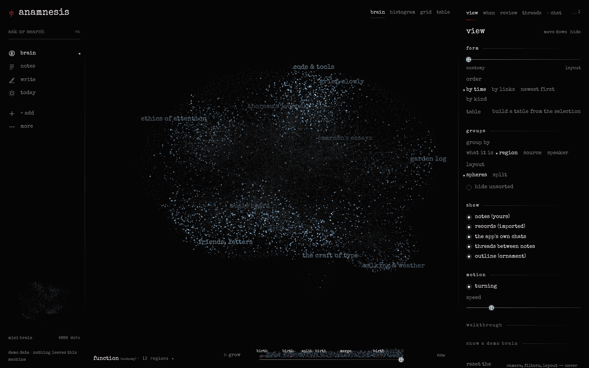
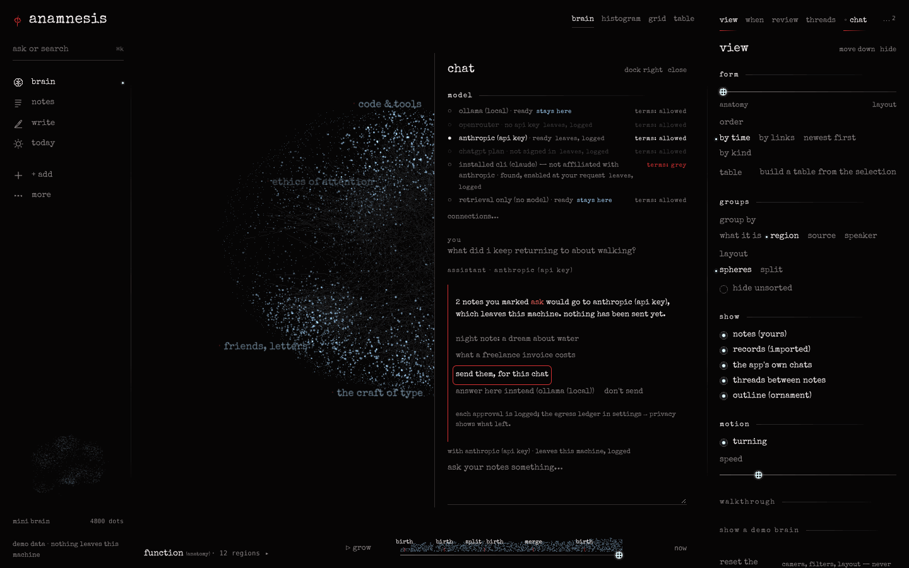
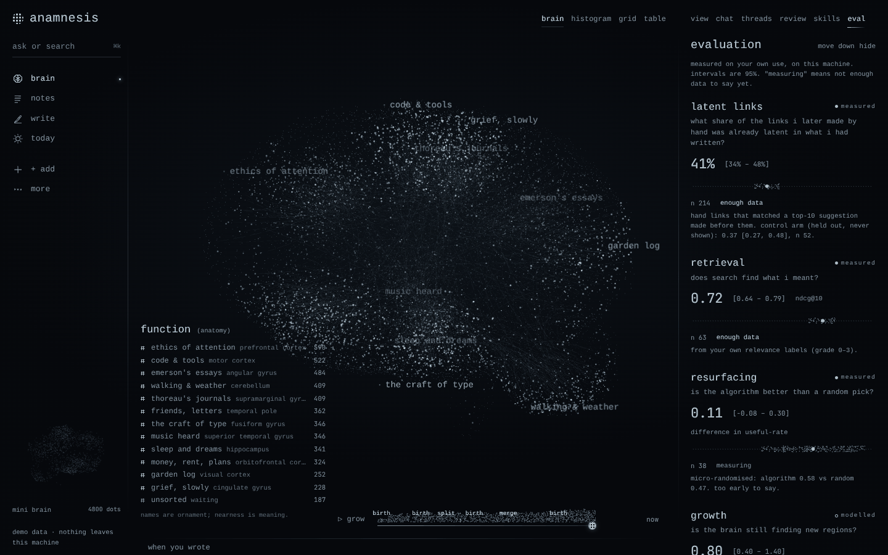
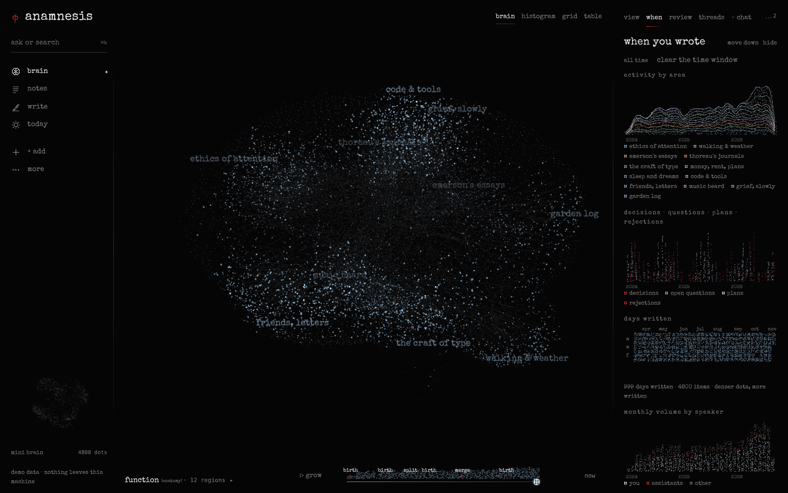
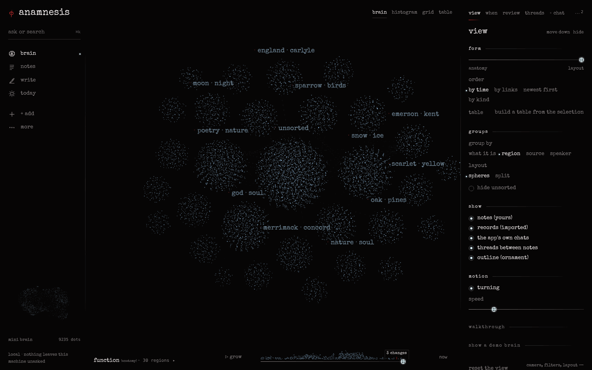
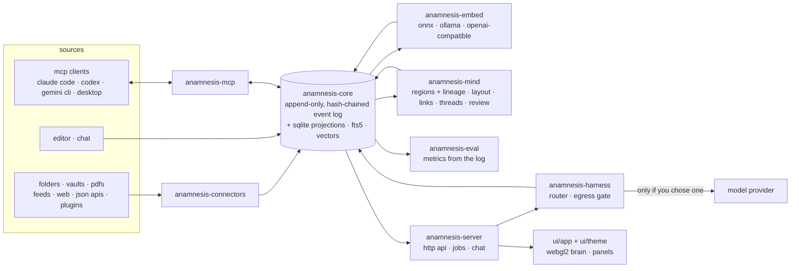

# anamnesis

a local-first second brain that measures itself.

anamnesis gathers what you write and read (notes, journals, obsidian vaults, pdfs, feeds, web clips, chats) into one brain on your own machine. every item is a dot in a turning 3d stipple cloud; similar items gather into regions that keep their identity as the brain grows, and you can replay how they were born, split and merged. everything that changes the brain is an event in an append-only, hash-chained log, and that log drives a built-in evaluation that asks one question of your own writing:

> is learning recollection? what share of the links i later make by hand was already latent in what i had written?

it is one rust binary with a browser ui, works with no model at all, brings your own model when you want one (local, api key, or your chatgpt plan through openai's sign-in), and is also an mcp server, so claude code, codex, gemini cli and claude desktop can read and write your brain with the subscriptions you already have.



<sub>screenshots show the ui running on its built-in sample data (`?mock=1`), not anyone's notes; the numbers in them are fixtures.</sub>

| | |
|---|---|
|  |  |
|  |  |

## what it does

- **one brain from many sources.** folders and obsidian vaults (wikilinks, embeds, frontmatter), pdfs, rss / atom / json feeds, web clips, json apis, an editor, chat, and anything else through a json-lines plugin protocol. incremental sync, renames and deletes followed.
- **regions with memory.** hdbscan clusters matched run to run (jaccard, hungarian matching, monic transitions) so a region keeps its id and name; births, splits, merges and deaths are logged and replayable.
- **a stable 3d layout.** umap-style, warm-started and procrustes-aligned so the brain does not reshuffle as it grows; new items are placed without moving the rest. three forms to morph between: anatomy, plain layout, spheres.
- **provenance everywhere.** every item says who wrote it (you, you in a chat, a model, a model editing you, someone else), where it came from and when. model text never passes for yours.
- **hybrid search** (bm25 + on-device embeddings, fused) with citation spans; **chat** that answers from your brain and cites it, or with no model, lists what it holds.
- **threads:** decisions, open questions, plans and rejections found in your writing, with the verbatim quote, tracked to resolution.
- **review:** a few items a day worth seeing again, run as a micro-randomised trial against random picks.
- **an evaluation you can trust:** held-out controls, intervals, sample sizes, "measuring" until there is enough data, and an honesty table.
- **privacy by construction:** local by default, per-source privacy flags, an egress ledger of every remote call, an mcp surface with no delete and no fetch.
- **yours to restyle:** themes, colours, fonts, logo, motion and panel layout, all from settings.

## quick start

build from source (rust 1.90+; the first build downloads the onnx runtime for local embeddings):

```sh
git clone https://github.com/aphesist/anamnesis
cd anamnesis
cargo build --release -p anamnesis-server
./target/release/anamnesis import ~/notes          # a folder or an obsidian vault
./target/release/anamnesis serve --open            # http://127.0.0.1:7368/
```

the first run downloads the local embedding model (~465 MB). to try it instantly and offline, add `--hash-embedder` to both commands. [docs/install.md](docs/install.md) has the details; [docs/using.md](docs/using.md) is a tour.

**the demo brain.** to see a brain with half a century of dated writing in it, build the transcendentalist demo (the journals of thoreau and emerson, public domain in the us and brazil) with the optional python lab:

```sh
cd lab && uv run anamnesis-lab demo transcendentalist && cd ..
./target/release/anamnesis serve --demo --demo-bundle lab/out/transcendentalist/notes
```

`--small` builds an offline 290-note sample in seconds. [docs/demo.md](docs/demo.md).

## bring your own model

anamnesis never ships or resells a model. it routes each task to a backend you configure, local first; background work never runs on a subscription, and nothing falls back silently to a paid backend. status is the provider's own terms as of 2026-11-11, with dated quotes and links in [docs/models.md](docs/models.md#provider-terms).

| provider | route | in anamnesis | terms |
|---|---|---|---|
| **anthropic** | your claude code / claude desktop / claude.ai connector, over mcp | yes | allowed |
| | api key | yes | allowed |
| | your own installed `claude` cli, signed in by you | opt-in, chat only | **grey** |
| | collecting claude.ai tokens, in-app claude login, account rotation | no | not offered |
| **openai** | codex over mcp | yes | allowed |
| | api key (or any openai-compatible host, openrouter) | yes | allowed |
| | **Continue with ChatGPT** (openai's sign-in for open-source local apps) | yes, chat only, experimental | allowed (preview) |
| | reusing codex's stored login | no | not offered |
| **google** | gemini cli / antigravity over mcp | yes | allowed |
| | gemini api key (ai studio) | yes | allowed |
| | consumer-plan logins (gemini cli / antigravity oauth) | no | not offered: google's terms prohibit third-party use |
| **local** | ollama, llama.cpp, lm studio, vllm (auto-detected) | yes, the default | allowed |

the installed-cli route is off until you turn it on, and shows this notice wherever it appears:

> uses your own claude login through anthropic's official cli. anthropic has not explicitly approved third-party apps doing this and could restrict it at any time; the safest routes are the mcp server and an api key. anamnesis never reads your credentials.

### optional, grey: label requests as anamnesis

off by default. when you turn it on (settings → connections → claude cli · relabel), requests from the installed claude cli are labelled `anamnesis` instead of the cli's own label, which changes how they are likely to be metered against your plan. other tools do the same (openbot; nous research's hermes plugin). anthropic has not documented the weighting or said whether third-party apps may do this, so it could be treated as getting around your plan's limits; it affects only your own account. the project removes the option the moment anthropic says it is not allowed. you see this before it turns on:

> label requests as "anamnesis" instead of the cli's own label. claude code meters requests differently depending on how they say they were made; scripted (agent sdk) requests have been reported to count about twice as heavily against your plan limits. with this on, anamnesis's requests identify themselves as coming from anamnesis rather than as agent sdk calls, so they are likely to be metered like interactive use. anthropic has not documented this weighting or said whether third-party apps may do this. it is a grey area: it could be treated as getting around your plan's limits, and anthropic can restrict or suspend accounts without notice. it affects only your own account. anamnesis turns this off for everyone if anthropic says it is not allowed.

the cli route also cleans its environment (no stray api key, endpoint or cloud-provider switch can move it off your login) and, by default, keeps your own claude code setup (CLAUDE.md, auto memory, hooks, skills, slash commands) out of anamnesis chats.

### what anamnesis will not do

- read your credentials (the claude cli's login, codex's or gemini's auth files, another app's keychain entries)
- copy tokens: the only token it holds is its own, from openai's sign-in
- rotate between accounts or fail over from one plan to another
- relabel traffic without asking: the claude cli's own request label is left alone unless you turn on the optional "label requests as anamnesis" switch (see above), and anamnesis never poses as another client
- run background jobs (labelling, extraction, anything scheduled) on a subscription

## privacy

- **local first.** one sqlite file in your data directory; no account, no telemetry. the server binds to `127.0.0.1` and refuses non-loopback hosts. embeddings run on your machine.
- **egress ledger.** every call to a remote model is checked by an egress gate and logged as an event: provider, model, purpose, item ids, character count. never the text. mcp reads are logged the same way.
- **privacy flags.** `cloud_ok`, `ask` (chat asks before sending) or `local_only` (never sent to a remote model, withheld from mcp clients), set per source.
- **mcp is read + append only.** no delete tool, no fetch or send tool, every write attributed to the client, generated text labelled as generated.
- **keys in the keychain**, never in settings, the log or an export.

[docs/privacy.md](docs/privacy.md) says exactly what is and is not covered.

## the evaluation

built in, on your own use, from the event log ([docs/evaluation.md](docs/evaluation.md)):

- **latent links.** about 20% of link suggestions are held out at random and never shown. later hand-made links that land on held-out suggestions estimate how much of what you link was already predictable from what you had written (an inverse-propensity estimate), next to the shown arm so the effect of suggesting is visible.
- **retrieval** on your own relevance labels: ndcg@10, p@5, mrr with bootstrap intervals, "measuring" below 25 labelled queries.
- **resurfacing** as a micro-randomised trial: each daily slot is the algorithm's pick or a random one, rated useful or not; bayesian intervals and a power-based threshold.
- **growth and lineage:** items, links and regions over time; births, splits, merges, deaths.
- every metric has a novelty split (first 28 days vs after), because new features get rated kindly. acceptance rate is shown but labelled as not a quality measure.

### the honesty table

| claim | status | basis |
|---|---|---|
| on beir scifact, ndcg@10 is 0.327 (hash), 0.659 (bm25), 0.682 (multilingual-e5-small, the default embedder) | **measured** | lab benchmark, 300 queries, 95% bootstrap intervals in [lab/README.md](lab/README.md) |
| on beir nfcorpus, ndcg@10 is 0.125 / 0.305 / 0.306 | **measured** | lab benchmark, 323 queries |
| layout trustworthiness ≈ 0.67 (umap, warm-started umap and pacmap; 2,000 demo notes, hash embeddings); warm-started umap roughly halves drift between growing snapshots | **measured** | lab benchmark (python reference methods; the rust layout is not yet in that harness) |
| regions over 20,000 × 384-d vectors take 0.1–0.16 s; a fresh layout 5.5–7.9 s | **measured** | `anamnesis-mind` benchmark on a loaded 4-core machine |
| search finds what you consider relevant | measured per user, in the app | your relevance labels; "measuring" below 25 queries |
| resurfaced items are more useful than a random pick | measured per user, in the app | micro-randomised trial; a hypothesis until each arm has ~95 ratings |
| a share of the links you make by hand was already latent in what you had written | **modelled**, per user, in the app | inverse-propensity estimate on held-out suggestions; assumes exposure does not change your unpredicted links; needs ≥ 50 hand links |
| link suggestions on the demo brain | demonstration | its links were added by a script; never reported as a metric |
| "it thinks like you" | **hypothesis** | not measured |
| learning is recollection | **hypothesis** | the philosophical frame: the number informs it, it cannot prove it |

## architecture



every change is an event; items, links, threads, regions and suggestions are projections that replay from the log; embeddings and the layout are caches. more in [docs/architecture.md](docs/architecture.md).

## repository layout

| path | what |
|---|---|
| `crates/anamnesis-core` | data model, event log, sqlite storage, chunking, hybrid search, bundles |
| `crates/anamnesis-connectors` | built-in connectors and the plugin runtime ([PLUGINS.md](crates/anamnesis-connectors/PLUGINS.md)) |
| `crates/anamnesis-embed` | embedding backends |
| `crates/anamnesis-mind` | regions, lineage, layout, link suggestion, threads, resurfacing |
| `crates/anamnesis-eval` | the built-in evaluation ([README](crates/anamnesis-eval/README.md)) |
| `crates/anamnesis-harness` | model backends, routing, limits, usage, egress gate |
| `crates/anamnesis-mcp` | the mcp server |
| `crates/anamnesis-server` | the `anamnesis` binary |
| `ui/app` | the browser ui (plain es modules, webgl2, no build step) |
| `ui/theme` | tokens, themes, fonts, settings, layout config ([README](ui/theme/README.md)) |
| `lab/` | optional python lab: demo-brain builders and benchmarks ([README](lab/README.md)) |
| `docs/` | [install](docs/install.md) · [using](docs/using.md) · [models](docs/models.md) · [mcp](docs/mcp.md) · [evaluation](docs/evaluation.md) · [privacy](docs/privacy.md) · [connectors](docs/connectors.md) · [theming](docs/theming.md) · [architecture](docs/architecture.md) · [demo](docs/demo.md) · [faq](docs/faq.md) · [http api](docs/contracts.md) |

contributing: [CONTRIBUTING.md](CONTRIBUTING.md). security: [SECURITY.md](SECURITY.md).

## licence

apache-2.0 ([LICENSE](LICENSE), [NOTICE](NOTICE)). the bundled Special Elite font is apache-2.0, © 2010 Astigmatic.

the default theme's identity assets (the Aphesis Script typeface, the φ mark and the wordmark) are **not** part of this repository or its licence: they are fetched at install time, the typeface is pending an SIL OFL 1.1 release by its author, and the marks are trademarks. without them the theme falls back to Special Elite and a placeholder mark. forks should use their own mark and display face. see [docs/theming.md](docs/theming.md#the-aphesis-theme-and-its-assets).
