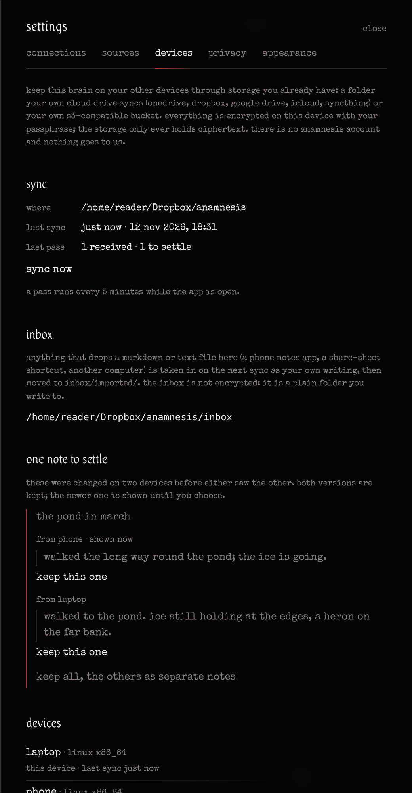

# sync across devices

keep one brain on your laptop, your desktop and (later) your phone, through storage **you** manage. anamnesis sells nothing here and runs no service: there is no anamnesis account, no anamnesis server, and nothing passes through us.

- **where:** a folder that your own cloud drive already syncs (onedrive, dropbox, google drive, icloud drive, syncthing, a network share), or an s3-compatible bucket you created yourself (cloudflare r2, aws s3, backblaze b2, minio…).
- **what:** the brain's event log, never the sqlite file. each device publishes its own hash-chained segment and replays the others'.
- **how safe:** everything is encrypted on the device before it is written. your passphrase becomes a key with argon2id; files are sealed with xchacha20-poly1305. the storage only ever sees ciphertext, plus the plain `inbox/` folder you write to yourself.



## set it up

1. on the first device: **more → settings & theme → devices**. choose **a folder** (for example `~/Dropbox/anamnesis`) or **an s3 bucket** (endpoint, bucket, region, an optional folder in the bucket, and an access key that can reach only that bucket), give this device a name if you like, and a **passphrase** of at least 8 characters. **start syncing** makes a new vault there.
2. on every other device: the same place (as that device sees it, e.g. its own path to the same dropbox folder) and **the same passphrase**. the device joins the vault.

the passphrase never leaves the device and is never stored: the device keeps the derived key in the os keychain (or, without one, in `secrets.json` next to the brain, mode 0600), and the s3 keys likewise, never in settings or in an export. **there is no way to recover a forgotten passphrase**: without it the vault is unreadable, also to you.

a pass runs a few seconds after the app starts, every 5 minutes while it runs, and on **sync now**. sync works on your own brain, never on the demo brain.

> join a device whose brain is empty, or one that never imported the same folders as another device: two devices that each imported the same vault on their own hold two copies of every note (different ids), and sync keeps both.

## what travels, and what does not

| travels | stays on the device |
|---|---|
| items you create, edit or delete (notes, chats, distilled notes, imported documents), with their privacy flags | the embeddings and the 3d layout (recomputed on each device) |
| sources (a folder source added on the laptop shows on the phone, but only the laptop runs its connector) | regions and their lineage, link suggestions and their hold-out, the daily review and its ratings, distil proposals: each device runs its own evaluation |
| references and links | threads found by extraction (each device extracts them again, with the same ids, so a status you set on one device applies on the others) |
| chat turns | the egress ledger (each device records what left it) |
| your status changes to threads | model backends, routing, the embedder, the mind's parameters, api keys |
| the settings `privacy`, `theme`, `motion` and `distil` | every other setting |

items flagged `local_only` travel too: sync is end-to-end encrypted between your own devices, and `local_only` means "never to a model that is not local". if a note must never leave this machine, keep it out of the synced brain.

## merging

every event a device publishes gets a **hybrid logical clock** timestamp (wall-clock milliseconds and a counter; kulkarni et al., 2014): close to real time, never going backwards on a device, and later than anything that device had already received. every device merges the others' events in (clock, device id) order, so all devices order them the same way.

- **creations, links, references, chat turns** are additions and simply merge.
- **settings, source changes and thread statuses** are last-writer-wins by clock.
- **item edits and deletions** carry the versions they replace. an edit made after seeing ours replaces it. an edit made **without** seeing ours (two devices changed the same note between syncs) is a **conflict**: both versions are kept, the one with the later clock is shown on every device, and settings → devices asks you: **keep this one** (either version, or the deletion), or **keep all** (the shown one stays the note, the others become separate notes "(from <device>)"). nothing is silently dropped. your choice travels like an edit and settles the conflict on the other devices too.

## the inbox

`inbox/` in the sync root is a **plain, unencrypted folder** for anything that is not anamnesis: a phone notes app saving markdown, a share-sheet shortcut, a script on another computer, you with a file manager. on the next pass, a device takes in every `.md`, `.markdown` and `.txt` file at any depth (outside `inbox/imported/`) as **your own writing** (origin "owner written", kind "note"; the title is a frontmatter `title:`, else a first `# heading`, else the first line, else the file name), then moves the file to `inbox/imported/<yyyy-mm-dd>/`. the note then syncs, encrypted, like any other. other files are left alone. (two devices passing at the same instant could both take a file in; the move makes that rare.)

a mobile app may come later; until then, any app that can write a text file into the synced folder (or put an object into the bucket under `inbox/`) adds to the brain.

## devices and unlinking

settings → devices lists every device of the vault with its platform and last sync. **unlink…** marks another device as unlinked: every device ignores its later changes, and it stops syncing when it next sees the mark (it tells you who unlinked it). an unlinked device still knows the passphrase; to lock a lost device out for good, make a new vault elsewhere with a new passphrase and join your other devices to it.

**stop syncing on this device** forgets the place and the key here. the brain on this device and the sync root stay as they are; joining the same vault again keeps the device's identity.

## the format (for anyone writing another client)

nothing in the format depends on anamnesis: a folder, json, sha-256, argon2id and xchacha20-poly1305.

```text
<sync root>/
  vault.json                                   plain json
  devices/<device id>/device.anb               sealed json: the device's name, platform, last sync
  devices/<device id>/unlinked.anb             sealed json: present once another device unlinked it
  devices/<device id>/batches/<first>-<last>.anb
                                               sealed json lines: that device's events first..=last
  inbox/                                       plain: drop .md / .txt here
  inbox/imported/<yyyy-mm-dd>/                 files already taken in
```

device ids are ulids; `<first>` and `<last>` are zero-padded to 12 digits. in a bucket the same paths are object keys under the configured folder.

### `vault.json`

```json
{
  "format": "anamnesis-sync",
  "version": 1,
  "vault_id": "<32 hex>",
  "kdf": { "alg": "argon2id", "salt": "<32 hex>", "m_kib": 65536, "t": 3, "p": 1 },
  "check": "<hex of the sealed bytes of \"anamnesis sync vault\">",
  "created_at": "<rfc3339>"
}
```

the key is argon2id (version 0x13) of the passphrase's utf-8 bytes with the salt and parameters, 32 bytes long. `check` is the plaintext `anamnesis sync vault` sealed with the key and the associated data `vault.json#check`: opening it verifies a passphrase.

### sealed files

`ANS1` (4 bytes) ‖ a random 24-byte nonce ‖ xchacha20-poly1305 ciphertext with its 16-byte tag. the **associated data is the file's path in the root** (e.g. `devices/01J…/batches/000000000001-000000000042.anb`), so a file moved to another name or another device's folder fails to open.

### events

a batch's plaintext is utf-8 json lines, one event per line:

```json
{ "device": "<device id>", "dseq": 42, "hlc": { "t": 1763000000000, "c": 0 },
  "at": "<rfc3339: when it happened on that device>",
  "actor": "user" | { "connector": "obsidian" } | { "mcp": "claude-code" } | …,
  "kind": { "type": "item_updated", "item": { … } },
  "parents": ["<version>", …],
  "prev": "<64 hex>", "hash": "<64 hex>" }
```

- `kind` and `actor` are anamnesis's own event kinds and actors, as in an export ([architecture.md](architecture.md#the-event-log), `crates/anamnesis-core/src/model.rs`).
- each device numbers its events 1, 2, 3… (`dseq`) and chains them: `hash = sha256(prev ‖ canonical json of the event without "hash")`, with `prev` of the first event 64 zeros. canonical json is json with object keys sorted, no insignificant whitespace (`crates/anamnesis-core/src/canon.rs`). a reader verifies the chain from the last event it took in; a gap, a reordering or a rewritten event breaks it, and that device's later batches are not imported until it is whole again.
- `parents` (item events only) are the item versions the event replaces. a version is the first 16 bytes, hex, of sha-256 over the canonical json of the item without `modified_at`; a deletion's version is `deleted:<item id>`.
- `hlc` orders the merge: sort by (`hlc.t`, `hlc.c`, `device`).

### `device.anb` and `unlinked.anb`

```json
{ "id": "<device id>", "name": "laptop", "platform": "macos aarch64", "created_at": "…", "last_sync_at": "…", "dseq": 42 }
{ "by_device": "<device id>", "by_name": "laptop", "at": "…", "up_to_dseq": 42 }
```

an unlinked device's events after `up_to_dseq` are ignored.

## what sync does not protect against

- **someone with the passphrase** (or the key from an unlocked device) can read and write the vault. unlinking does not take the passphrase back.
- **metadata:** the storage sees how many devices there are, when they sync and how large the batches are, and the plain inbox.
- **deletion by the storage:** a cloud drive or a bucket can lose or roll back files. a missing batch shows as a broken chain (that device's later changes wait); the brains on your devices are untouched. keep an export now and then (`anamnesis export`).
- **a weak passphrase:** argon2id makes each guess expensive (64 mib of memory, 3 passes), not impossible. use a long one.

the code is `crates/anamnesis-sync` (format, encryption, clocks, merging; tests with two and three simulated devices on one folder) and `crates/anamnesis-server/src/devices.rs` (the api and the background pass).
