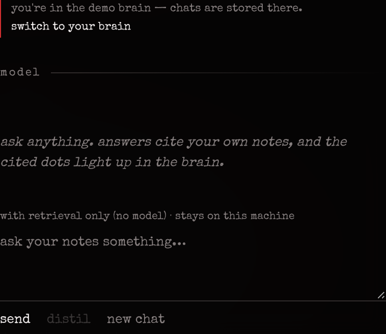
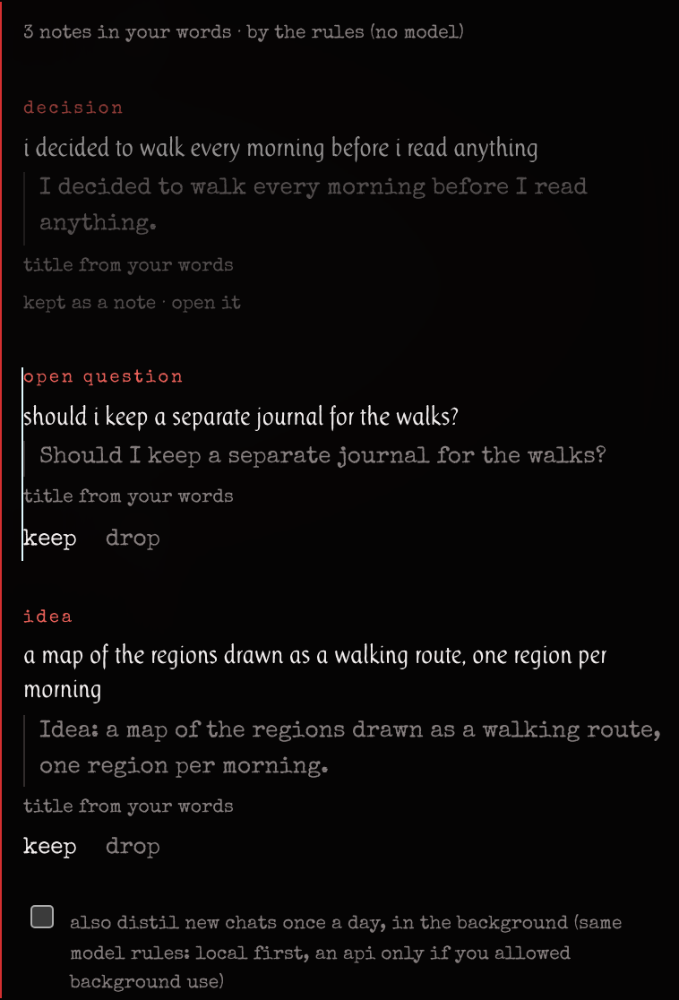

# using anamnesis

open the anamnesis app ([install.md](install.md)); everything below happens in its window. (headless, `anamnesis serve --open` shows the same interface in a browser at `http://127.0.0.1:7368/`.) where the interface does not cover something yet, the http call is given ([contracts.md](contracts.md)).

## sources and connectors

the brain fills from sources. in the sidebar, **+ add** offers a new note, or a source: a folder or vault, an obsidian vault, a folder of pdfs, a feed, or a link. type a path or url and add it; items appear as they are read, and folders keep syncing as you edit them.

from the command line:

```sh
anamnesis import ~/notes                     # a folder, or an obsidian vault if it has .obsidian/
anamnesis add-source rss --config '{"url":"https://example.org/feed.xml"}'
```

every source has a default **origin** (your own writing, or someone else's text) and a default **privacy** flag that its items inherit. a vault defaults to your own writing; pdfs, feeds and clips to external text. see [connectors.md](connectors.md) for every connector and its options, and [privacy.md](privacy.md) for the flags.

## the brain

each item is a dot. similar items sit close together, and close groups become **regions**, named by their keywords and, for ornament, by an area of the brain (the legend, **function (anatomy)**, lists them; hover or click to light one). drag to turn, scroll to zoom, click a dot to read it.

the **view** panel on the right shapes the cloud:

- **form**: a slider from *anatomy* (the cloud folded into a two-hemisphere brain) to *layout* (the raw similarity layout). nearness means similarity in both; the brain shape is ornament.
- **order**: by time, by links, newest first, or by kind.
- **groups**: group by what it is, region, source or speaker; lay groups out as *spheres* or *split* them apart; hide what is still unsorted.
- **show**: your notes, imported records, the app's own chats, the threads between notes, the outline.
- **motion**: turning on or off, and its speed.
- a **walkthrough** of the interface, and a **reset**.

above the cloud, the tabs switch to other views of the same items: **histogram**, **grid** and **table** (a table can be built from the current selection).

## time, growth and lineage

the **time** panel at the bottom is a timeline of when things were written. drag it to see the brain as it was; press **grow** to replay it filling up. marks on the line show region **births, splits and merges** from each clustering run: anamnesis keeps a region's identity across runs and records how regions divide and join, so you can watch a theme of yours split into two or two merge into one ([architecture.md](architecture.md#regions-and-lineage)).

**when you wrote** charts your writing over time by speaker: you, assistants, and other people's text. only your own words count as you.

## the editor

**write** in the sidebar opens the editor. a note's first line becomes its title. write `[[another note]]` to link: links you write count as your own links in the evaluation. notes you write here are stored with the origin "owner written".

## reading and link suggestions

opening an item shows its text, its links in and out, the threads found in it, its region, and **link suggestions**: items the brain thinks belong with it. **link** accepts one, **dismiss** declines it. about one in five suggestions is quietly held back and never shown, so that later the app can tell whether you would have made that link anyway ([evaluation.md](evaluation.md#latent-links)). to link two items by hand outside the suggestions, write a `[[wikilink]]` or use `POST /api/links {"from": …, "to": …}`.

## chat

the **chat** panel answers from your brain and cites the items it used as `[n]`. pick the model above the input; the choice says whether it stays on this machine or leaves it (and is logged). with no model configured, chat lists what your brain holds on the question and generates nothing. models: [models.md](models.md).

your chats are stored as items too (yours as "owner in chat", the assistant's as "ai generated"), so they can be searched and linked, and never pass for your own writing. items flagged `local_only` are never sent to a remote model; items flagged `ask` make chat ask first.

a fresh install opens on the demo brain, and a chat goes into whichever brain is open: the chat panel says *you're in the demo brain — chats are stored there* and offers **switch to your brain**.



### distil

a conversation is a poor place to keep a thought. **distil** (next to *send*, once the chat has a reply) reads **only your own messages** in this chat and proposes a few atomic notes, each one an **idea**, a **decision**, an **open question** or a **plan**:

- each proposal quotes **your exact words**, checked character for character against the message they came from (a quote that is not there verbatim is thrown away, as for threads), with a short title;
- **keep** turns it into a note of origin "owner in chat" whose text is your quote, linked to the chat message it came from, as private as that message. a title written by a model is marked as such on the note (`meta.distil.title_by`); **drop** discards it. nothing is stored until you keep it;
- with the keyboard: each proposal is focusable; **k** keeps, **d** drops, the arrows move, and focus goes on to the next open proposal.



what reads your messages: a **local model** when one is routed for extraction; else the routed `extract` api, **only if you allowed background api use** ([models.md](models.md)), and then only messages flagged `cloud_ok`, through the egress gate (logged); never a subscription (chatgpt, the claude cli). with no model, or when the model fails, the rule-based thread extractor proposes instead, with titles cut from your own words. distilling the same chat again proposes only what is new.

**also distil new chats once a day** (under the proposals; the setting `distil.daily`, off by default) runs the same distiller in the background on chats with new messages of yours, and leaves the proposals waiting: `GET /api/distil?status=pending` lists them. every keep and drop is recorded, and the evaluation reports how many proposals were worth keeping ([evaluation.md](evaluation.md#distilled-notes-worth-keeping)). over mcp, `distil` and `capture` do the same for a harness's conversations ([mcp.md](mcp.md#tools)).

## today and review

**today** gathers what you captured today, a few items **worth seeing again**, and **questions still open**. the review draws each day from items that are due, items near what you wrote recently, and old items far from your recent attention, and mixes in random picks as a control. rate each one **useful** or **not**: those ratings are how the app finds out whether its picks beat chance ([evaluation.md](evaluation.md#resurfacing-a-micro-randomised-trial)).

## threads

anamnesis finds **decisions**, **open questions**, **plans** and **rejections** in your writing (english and portuguese cue phrases, question marks, task checkboxes), each with the verbatim sentence it came from. the **threads** panel lists them; mark one resolved, abandoned or superseded, or **light these** to see where they sit in the brain.

## skills

items of kind `skill` (reusable instructions, prompts, procedures) are listed in the **skills** panel for quick reuse.

## evaluation

**more → evaluation** opens the panel: latent links, retrieval, resurfacing, distilled notes worth keeping and growth, each with its sample size, interval and status, and the honesty table. `anamnesis eval` prints the same table in a terminal. relevance labels for retrieval are recorded with `POST /api/eval/label {"query": …, "item_id": …, "grade": 0-3}`. read [evaluation.md](evaluation.md) before reading too much into a number.

## search

**ask or search** at the top of the sidebar (`⌘k` / `ctrl+k`) searches words and meaning together.

## settings

**more → settings & theme** changes the theme, colours, fonts, motion, marks and panel layout ([theming.md](theming.md)). **more** also toggles light and dark, reduces motion, and shows or hides panels. model backends and sources' privacy are configured through the api for now ([models.md](models.md), [privacy.md](privacy.md)).

## your other devices

**more → settings & theme → devices** keeps this brain on your other devices through a folder your own cloud drive syncs or your own s3-compatible bucket, encrypted on the device with a passphrase. it lists the linked devices and their last sync, asks you to settle a note changed on two devices at once, and shows the plain **inbox** folder: markdown or text files dropped there by anything (a phone notes app, a shortcut) become your notes on the next sync. see [sync.md](sync.md).

## export and backup

```sh
anamnesis export ~/anamnesis-backup.jsonl
anamnesis verify
```

the export is the whole event log; `anamnesis import` replays it into an empty brain.

## the demo brain

to see a filled brain without your own notes, build the transcendentalist demo ([demo.md](demo.md)). the **show a demo brain** button in the view panel shows a read-only sample cloud from the ui's own fixtures, without a server.
