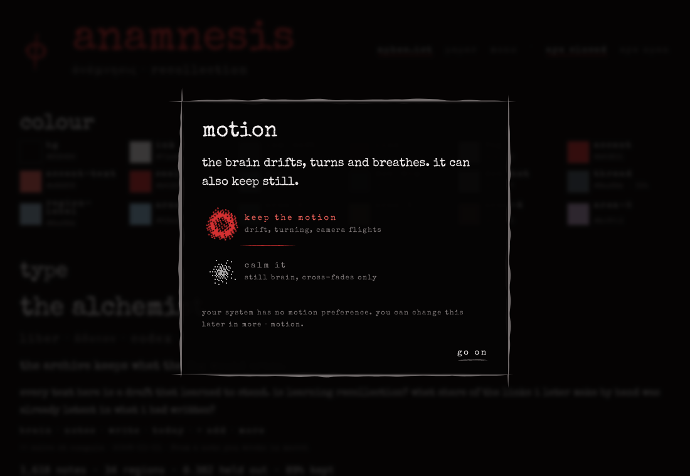
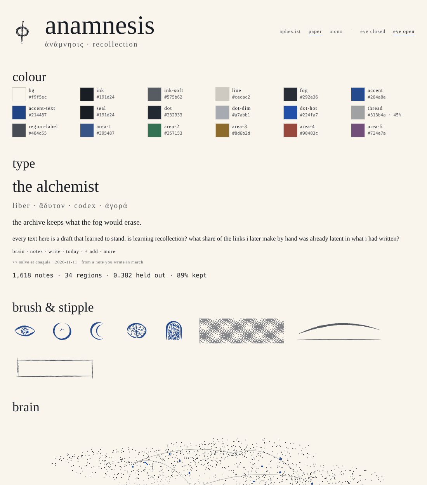
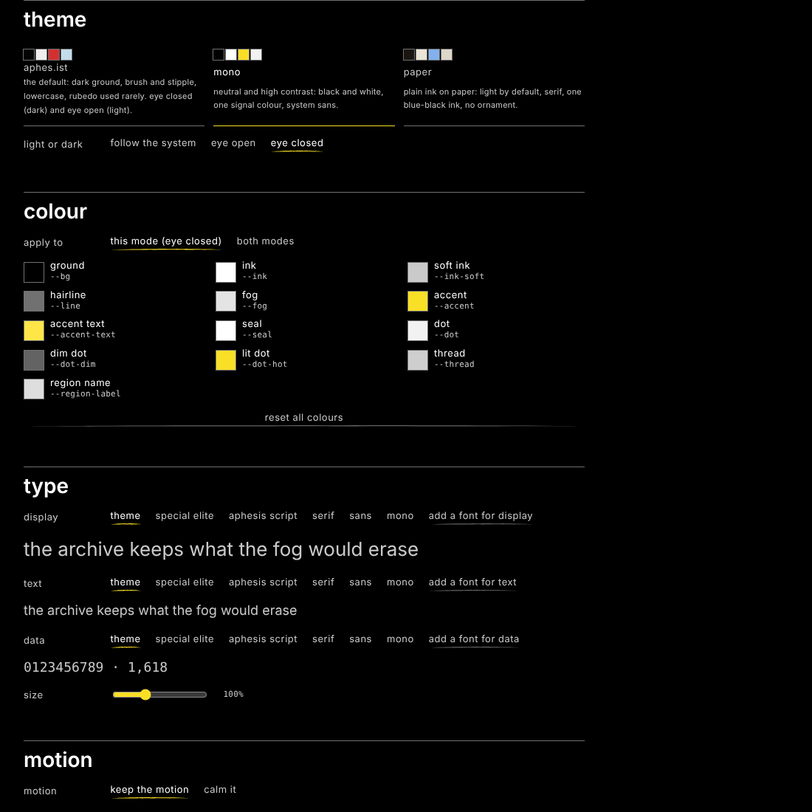

# ui/theme

design tokens, themes, fonts, marks, the theme runtime, the first-launch motion choice, the settings panel and the panel layout config for anamnesis. plain es modules, no dependencies, no build step needed to run: the generated css is committed.



## what is here

| path | what |
|---|---|
| `tokens/base.tokens.json` | base design tokens, [W3C Design Tokens Format 2025.10](https://www.w3.org/community/reports/design-tokens/CG-FINAL-format-20251028/) |
| `themes/<id>/` | a theme: `theme.json` (manifest), `tokens.json` (both modes), `light.tokens.json`, `dark.tokens.json` |
| `dist/<id>.css` | generated css custom properties, light and dark via `data-theme` on `<html>` (committed) |
| `dist/<id>.json` | the same values resolved, with hex and linear rgb per colour (for the webgl renderer) |
| `dist/index.json` | the theme list, with preview swatches |
| `theme.css` | browser defaults and type roles drawn from the tokens (focus, selection, fields, hidden scrollbars, cursor disc, `.anm-*` classes) |
| `theme.js` | runtime: apply a theme, mode, motion, overrides, fonts, logo, export / import, `anamnesis:themechange` |
| `motion.js` | the first-launch "keep the motion / calm it" dialog |
| `cursor.js` | the difference-blend cursor disc (on in the aphes.ist theme, off elsewhere) |
| `settings.js` | the settings panel the app mounts |
| `layout.js`, `layouts/*.json` | panel layout config (`default`, `minimal`) and its json schema |
| `brush.js` | brush strokes and stipple as svg path data, when `window.Aphesis` is not loaded |
| `tokens.js` | the token compiler, shared by the build script and the runtime |
| `fonts/` | Special Elite (Apache-2.0), bundled |
| `marks/` | placeholder φ (stipple) and wordmark, generated by the build |
| `themes/aphesis/assets/` | Aphesis Script and the φ, fetched at install time, **not committed** (see its `NOTICE.md`) |

## using it in the app

```html
<link id="anamnesis-theme-css" rel="stylesheet" href="/theme/dist/aphesis.css">  <!-- styled before js runs -->
<link rel="stylesheet" href="/theme/theme.css">
<script type="module">
  import * as theme from '/theme/theme.js';
  import { askMotionOnce } from '/theme/motion.js';
  import { startCursor } from '/theme/cursor.js';
  import { getLayout, onLayoutChange } from '/theme/layout.js';

  await theme.init();            // stored choice, else aphesis; syncs with /api/settings when served over http
  startCursor();                 // shows only while <html data-cursor="custom">
  await askMotionOnce();         // asks once; pre-selects the os reduced-motion setting
  buildPanels(await getLayout());
  onLayoutChange(buildPanels);
  window.addEventListener('anamnesis:themechange', () => renderer.setColours({
    dot: theme.tokenRGB('--dot').linear, hot: theme.tokenRGB('--dot-hot').linear, /* … */
  }));
</script>
```

the ui reads only the custom properties in `docs/contracts.md`:

- colour roles `--bg --ink --ink-soft --line --fog --accent --accent-text --seal`
- brain `--dot --dot-dim --dot-hot --thread --region-label`
- type `--font-display --font-text --font-data --type-scale`
- motion `--ease --dur-short --dur-mid --dur-long --motion` (`1` full, `0` reduced)
- spacing `--space-1` … `--space-9` (4 8 12 20 32 52 84 136 220px)
- marks `--mark --wordmark` (urls; draw them as a css mask with `background: var(--seal)` so they take the theme's colour, see `.anm-mark`)

extras every theme also sets: `--veil` (selection), `--area-1…8` (categorical colours for regions), `--dur-theme`, `--dur-shift`, `--type-size-*`, `--type-leading-*`, `--type-tracking-*` (em), `--type-display-slant`, `--type-display-weight`, `--z-*`.

switches on `<html>`, set by `theme.js`: `data-theme="light|dark"`, `data-motion="full|reduced"`, `data-cursor="custom|system"`, `data-scrollbars="hidden|system"`, `data-theme-id`.

### theme.js api

| call | does |
|---|---|
| `init({ server, defaultTheme })` | applies the stored theme; `server: 'auto'` (default) reads/writes `/api/settings` when served over http |
| `listThemes()` | built-in and imported themes |
| `applyTheme(id)` / `setMode('system'\|'light'\|'dark')` | switch theme / mode |
| `setMotion('full'\|'reduced'\|null)` | `null` follows the os until the person chooses |
| `setCursor('custom'\|'system'\|null)`, `setScrollbars('hidden'\|'system'\|null)` | `null` follows the theme |
| `setToken(name, value, 'all'\|'light'\|'dark')`, `setOverrides`, `clearOverrides` | override any token |
| `setTypeScale(n)` | 0.6–2 |
| `setFont(role, stack)`, `addFont(role, File \| { url })` | `role` is `display`, `text` or `data`; uploads live in IndexedDB |
| `setLogo(File \| { url } \| null, 'mark'\|'wordmark')` | svg or png; uploads live in IndexedDB |
| `exportTheme()`, `importTheme(json)`, `registerTheme(def)` | share a look as json (fonts and logos embedded as data urls) |
| `readToken(name)`, `tokenRGB(name)` | current value; colours as `{ r, g, b, linear, alpha, hex }` |
| `getState()`, `onThemeChange(fn)`, `reset()` | |

every change dispatches `anamnesis:themechange` (a `CustomEvent` on `window`; `detail` is the state plus `reason`). the theme stylesheet is swapped only after the new one loads, so the event fires when the new values are readable.

persistence: `localStorage` keys `anamnesis.theme`, `anamnesis.layout`, `anamnesis.themes.custom`; files in IndexedDB database `anamnesis-theme`. every access is wrapped: without storage the choices simply are not remembered. with the server, the theme state is merged into `/api/settings` as `{ theme: {…}, motion: 'full'|'reduced' }` (uploaded files stay on the device; only url references are sent).

### the settings panel

```js
import { mountSettings } from '/theme/settings.js';
const panel = await mountSettings(document.querySelector('#appearance'), { onLayoutChange: buildPanels });
```

sections: theme and mode, colour (pickers for the roles and brain tokens, per mode or both), type (font per role, upload, size), motion (motion, cursor, scrollbars, ask again), mark (upload mark and wordmark), layout (show / hide, starts open, region, order, presets), keep (export, import, reset).

### layout

`layouts/default.json` follows `layouts/layout.schema.json`:

```json
{ "id": "sidebar-left", "label": "nav", "region": "left", "order": 0, "open": true, "visible": true, "size": 72, "sections": ["ask-or-search", "brain", "…"] }
```

regions are `left`, `right`, `bottom`, `overlay` (overlay panels have an `anchor`). panels: `sidebar-left`, `view-right`, `legend-bottom-left`, `when-you-wrote`, `timeline-bottom`, `chat`, `review`, `threads`, `eval`, `skills`. the app should ignore ids it does not know and keep working when one is missing.

## making a theme

1. copy `themes/paper/` to `themes/<your-id>/` and set `"id"` in `theme.json` to the folder name.
2. edit the tokens. only write what differs from `tokens/base.tokens.json`; files merge in this order: base → `tokens.json` → `light.tokens.json` or `dark.tokens.json`.

   ```json
   {
     "role": {
       "$type": "color",
       "bg":     { "$value": { "colorSpace": "oklch", "components": [0.97, 0.012, 85] } },
       "accent": { "$value": "{color.rubedo}" }
     },
     "brain": { "$type": "color", "dot": { "$value": { "colorSpace": "oklch", "components": [0.3, 0.02, 260] } } },
     "font":  { "$type": "fontFamily", "display": { "$value": ["Iowan Old Style", "Georgia", "serif"] } }
   }
   ```

   the css name is the token path joined with `-`; groups marked `"$extensions": { "ist.anamnesis": { "flatten": true } }` (`role`, `brain`) drop out of the name, so `role.bg` is `--bg`. groups marked `"emit": false` (the `color` primitives) are only for aliases. aliases use curly braces with the full path. colours may be the 2025.10 object form or a css colour string.
3. fonts: put files in your theme folder and list them in `theme.json` → `fonts` (`{ family, src, weight }`, `src` relative to the folder) for faces that are always there, or `optionalFonts` for faces fetched later.
4. marks: `theme.json` → `marks.mark` / `marks.wordmark` with `src` (optional asset, used when present in `assets/fetched.json`) and `fallback` (always present).
5. `behaviours`: `{ "cursor": "custom"|"system", "scrollbars": "hidden"|"system" }` — defaults the person can change.
6. run `node ui/theme/scripts/build-tokens.mjs`, commit `dist/`. `node --test ui/theme/test/*.test.mjs` checks that every contract variable exists in both modes and that ink, ink-soft and accent-text keep 4.5:1 (ink 7:1) on the ground.

a person can also make one without the repo: settings → keep → export gives a json file whose `overrides` can be edited by hand; a file with `"theme": { "id", "name", "defaultMode", "tokens": { "common", "light", "dark" } }` registers a full token theme on import.

## commands

```sh
node ui/theme/scripts/build-tokens.mjs          # tokens -> dist/*.css, dist/*.json, marks/*.svg
node ui/theme/scripts/build-tokens.mjs --check  # fail if dist is stale
node ui/theme/scripts/fetch-aphesis-assets.mjs  # Aphesis Script + φ into themes/aphesis/assets/ (gitignored)
node --test ui/theme/test/*.test.mjs            # or: cd ui/theme && npm test
python3 -m http.server -d ui/theme 8765         # then open http://127.0.0.1:8765/demo.html
```

`npm install` inside `ui/theme` runs the asset fetch as `postinstall`; it never fails the install (`ANAMNESIS_SKIP_ASSET_FETCH=1` skips it).

## the aphes.ist theme and its rules

the default theme reproduces the aphes.ist design system: the eight role tokens on an oklch neutral scale at hue 25, rubedo as the one accent, fibonacci spacing, one settling easing, lowercase, brush and stipple, the cursor disc and hidden scrollbars. where an app differs from a website it is deliberate and switchable: motion asks once (pre-selecting the os setting) and can be calmed later; the cursor disc and hidden scrollbars are on by default and settings restores the system ones; panels sit in calm zones with hairline rules.

`brush.js` is an independent implementation inspired by the documented aphes.ist api (`brush`, `arc`, `line`, `stipple`, `MJ`); when the aphes.ist runtime is present the app may use `window.Aphesis` instead.

## licences

- code, tokens, generated css, placeholder marks: Apache-2.0, as the rest of anamnesis.
- Special Elite: Apache-2.0, © 2010 Brian J. Bonislawsky DBA Astigmatic (AOETI); see `fonts/NOTICE.md`.
- Aphesis Script, the φ and the wordmark: **not** part of this repository and not under Apache-2.0. see `themes/aphesis/assets/NOTICE.md`. the font is to be licensed OFL-1.1 with the reserved font name "Aphesis Script" once its author publishes the licence; until then it is only fetched at install time. the φ and wordmark are the owner's trademarks.



